

# 亿级流量点赞系统（yu-like）

**基于 Spring Boot 3 + Java 21 + TiDB + Redis + Pulsar + Docker + Nginx 的高并发分布式点赞系统实战项目**

由 [编程导航团队](https://www.codefather.cn/) [@松柏](https://www.codefather.cn/user/1626574509983178753) + [@yes](https://www.codefather.cn/user/1788461898925084673) + [@程序员鱼皮](http://dogyupi.com/) 联合打造

[视频介绍](https://www.bilibili.com/video/BV1Eq5DzcE9o) · [免费试看课程](https://www.codefather.cn/course/yulike) · [项目介绍](#-项目介绍) · [三大架构阶段](#-项目三大阶段演进) · [核心收获](#-项目收获) · [技术选型](#-技术选型与仓库结构) · [常见问题](#-常见问题) · [加入学习](#-加入编程导航学习)

---

## 📖 项目介绍

点赞功能几乎是每一个社交平台、资讯社区与内容产品最核心的高频互动入口，看似简单，但在大流量与高并发场景下却是一块极具挑战性的硬骨头。为了帮助后端开发者真正跨越普通增删改查的瓶颈，我们团队在 [编程导航](https://www.codefather.cn/vip) 推出了这套进阶实战教程 —— **亿级流量点赞系统（`yu-like`）**。

本项目基于 Spring Boot 3、Java 21 虚拟线程、MyBatis-Plus、TiDB 分布式数据库、Redis、Apache Pulsar、Docker 与 Nginx 构建，聚焦高并发、高性能、高可用与全链路可观测性四大核心命题。整套教程提供详尽的文字教程、分节源码、简历写法、面试题解与答疑服务，你可以先通过下方的全景架构图直观感受这个项目的技术含金量，或者直接观看 [B 站项目介绍视频](https://www.bilibili.com/video/BV1Eq5DzcE9o) 快速了解整体脉络。

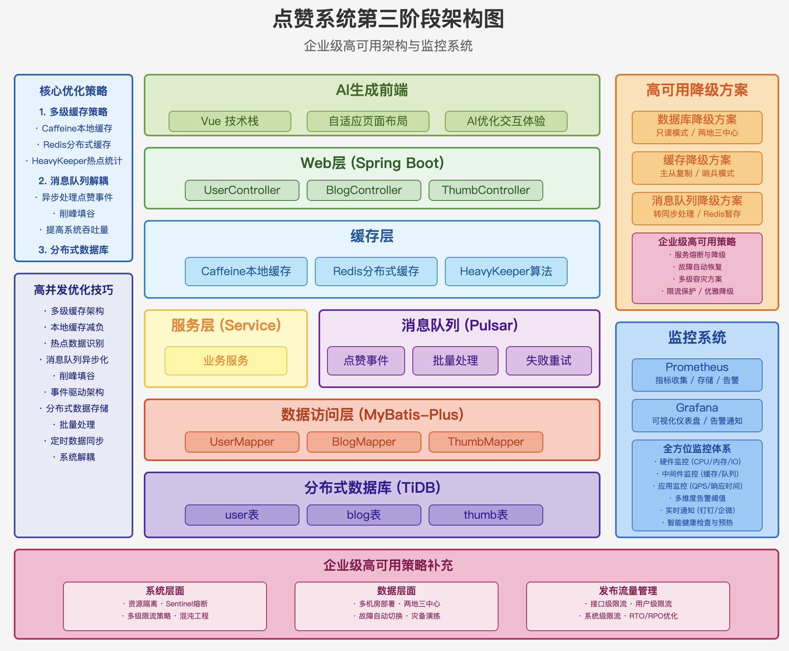

鱼皮团队一直坚持以真实企业级标准打磨每一套实战项目，这份真诚与扎实也收获了大量开发者的认可，帮助许多同学在面试高并发场景题时游刃有余并顺利斩获理想 Offer。

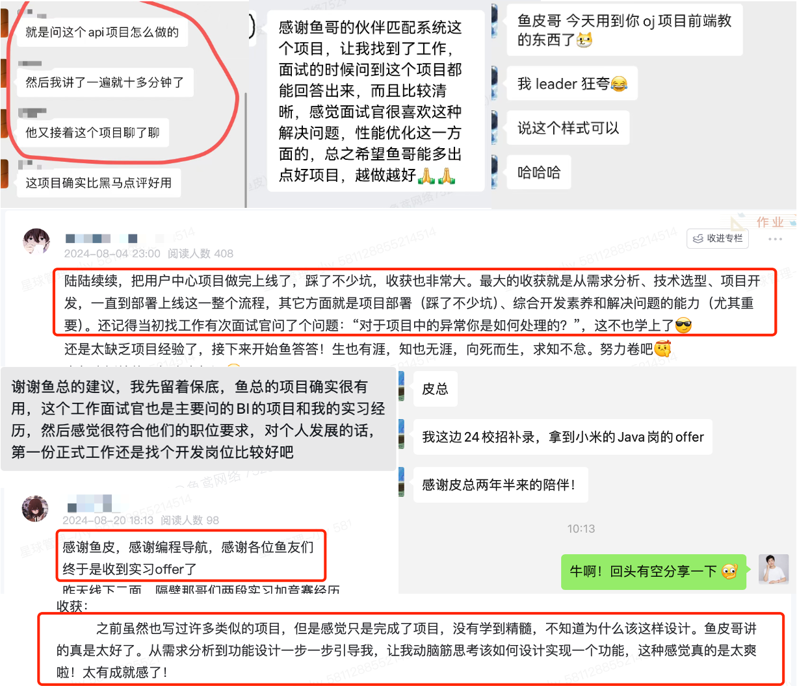

> 温馨提示：本项目偏重高并发与分布式底层架构演进，具有一定技术门槛，更适合已经掌握 Spring Boot 基础开发、希望向中高级后端工程师进阶或为简历补充硬核高并发亮点的开发者深入学习。你可以前往 [编程导航亿级流量点赞系统专栏](https://www.codefather.cn/course/yulike) 免费试看核心章节。

## 📐 项目三大阶段演进

为了让你既能看得懂原理、又能跟着一步步写出可运行的生产级代码，我们将整个系统拆解为三个由浅入深的演进阶段，真实还原互联网大厂从基础功能逐步升级为亿级流量高可用架构的完整历程。

### 第一阶段：基础功能快速落地

在第一阶段，我们会使用 Spring Boot 3 与 MyBatis-Plus 从零设计点赞记录与统计数据模型，快速跑通核心点赞、取消点赞与状态查询流程。学完这一阶段后，你就可以直接把这套规范的点赞模块无缝集成到自己的任意业务项目中。

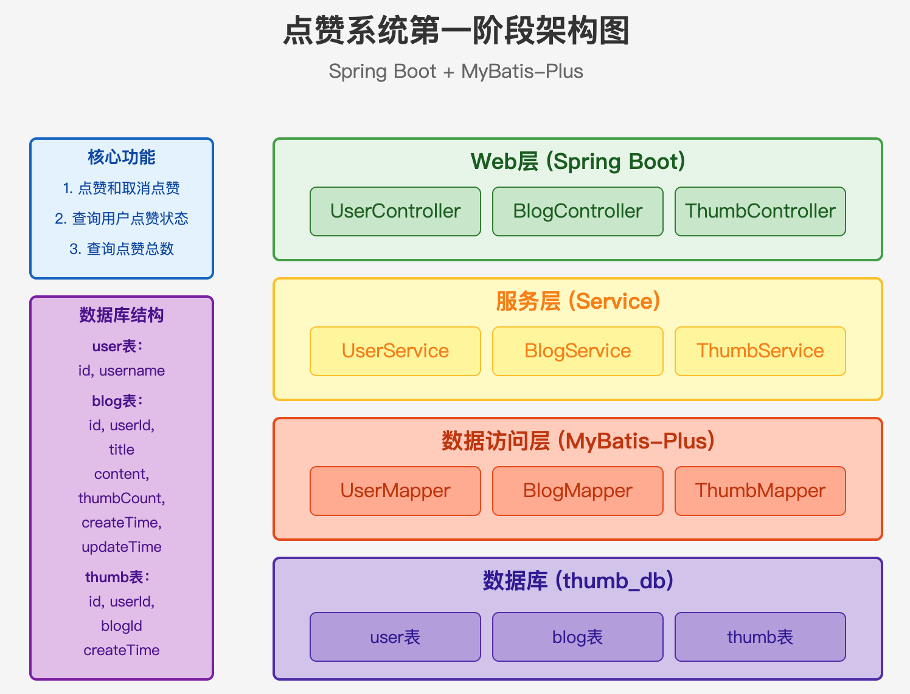

### 第二阶段：高并发与性能优化进阶

当业务流量飙升时，直接读写单机数据库会迅速成为瓶颈。因此在第二阶段，我们围绕缓存、消息队列与分布式存储展开深度优化：结合 Redis 多种数据结构与 Lua 脚本保证原子性、引入 HeavyKeeper 算法配合本地热点缓存扛住突发热点 Key、采用 Apache Pulsar 消息队列实现异步削峰与批量消费入库，并将底层存储平滑升级至支持自动水平分片的 TiDB 分布式关系型数据库，彻底打破单机写入与存储瓶颈。

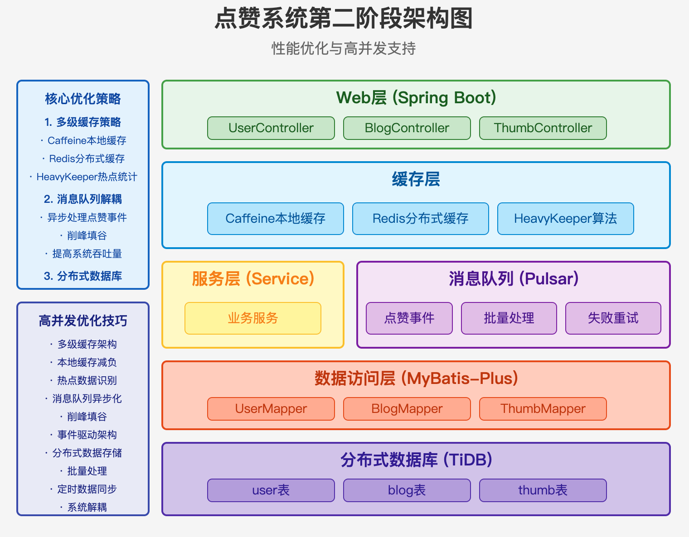

为了更清晰地展示异步削峰链路，下图呈现了引入 Pulsar 消息队列实现请求解耦与批量消费落盘的完整数据流转方案。

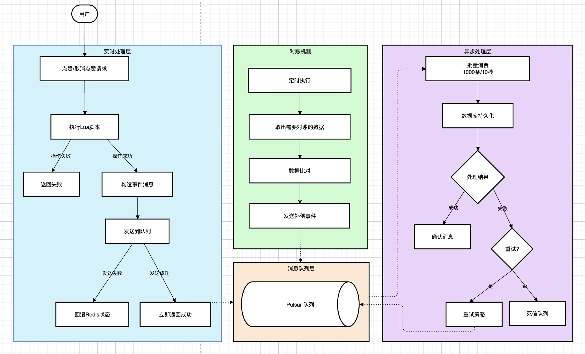

### 第三阶段：企业级高可用、可观测性与 AI 前端生成

面对真实线上环境的极端流量与中间件故障，第三阶段重点构建覆盖数据库、缓存与消息队列的多级降级与容灾保护机制，确保核心链路在异常情况下依然稳健不崩溃。

与此同时，没有监控的高并发系统如同在黑暗中狂奔。本阶段会带你基于 Prometheus、Grafana 与 Alertmanager 搭建多维度可视化监控面板与异常实时告警体系，完整掌握企业级系统的可观测性建设实践。

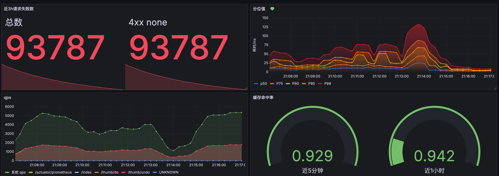

在完成后端全链路架构打造之后，课程还会实战如何完全借助 AI 编程高效生成交互友好的配套前端页面（源码位于仓库 `thumb-front` 目录），让后端开发者也能轻松端到端演示整套系统的运行效果。

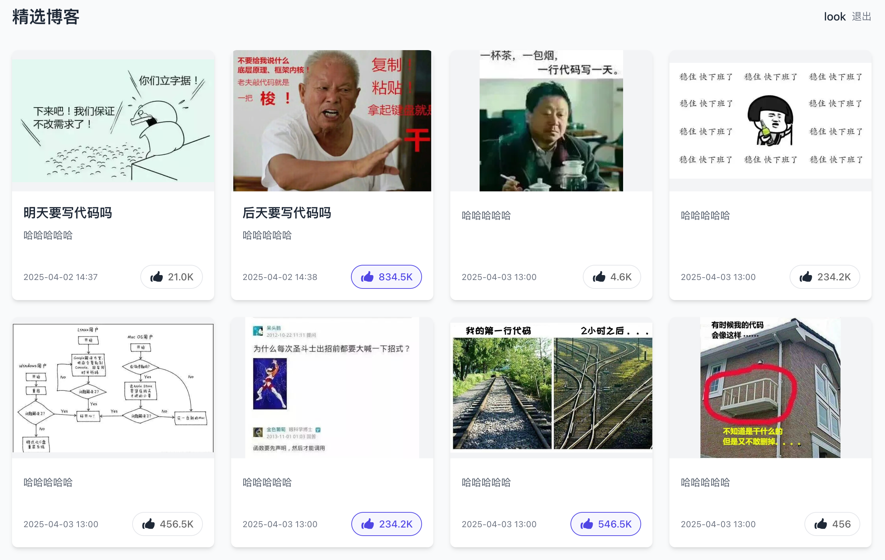

## 🎯 项目收获

区别于普通的单体业务练手项目，亿级流量点赞系统聚焦大厂后端面试与线上研发中最常考、也最值钱的高并发与架构设计套路。完整跟做并吃透这套项目之后，你将系统掌握以下核心工程能力。

在基础并发与存储建模层面，你会学会借助 Spring Boot 3 与 Java 21 虚拟线程大幅提升高并发请求响应吞吐量，合理设计兼顾查询效率与数据一致性的点赞记录与计数模型，并通过 TiDB 分布式关系型数据库的自动分片能力告别繁琐的手动分库分表。在缓存与削峰层面，你会实战运用 Redis 多种数据结构组合存储点赞状态、编写 Lua 脚本保证多条命令原子执行并减少网络 IO、结合 HeavyKeeper 热点探测算法与 TTL 本地缓存拦截超高频热点 Key，以及利用 Apache Pulsar 消息队列与批量消费机制化解写入洪峰。在高可用、可观测与全栈交付层面，你还将亲手落地覆盖 DB、缓存与消息队列的多级降级容灾方案，搭建 Prometheus、Grafana 与 Alertmanager 实时监控告警体系，配置 Nginx 反向代理与负载均衡，并体验借助 AI 快速生成配套前端界面的现代开发方式。

哪怕你目前还没有学过其中的部分中间件或前沿特性，也完全无需担心。鱼皮原创项目系列始终坚持从理论到实践、从需求拆解、技术选型、Demo 验证到最终架构调优逐一讲透，并配套丰富的真实学员正反馈与完整学习服务。

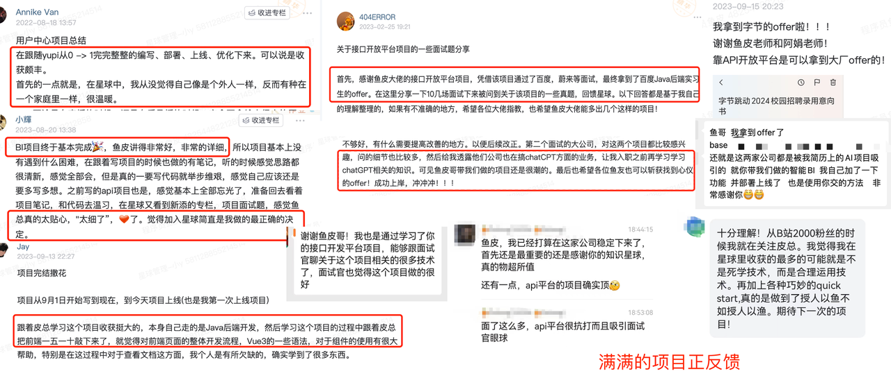

除了系统详尽的文字教程之外，成为编程导航会员还可以一站式获取分节整理的完整源码、详细直播与学习笔记、专属项目交流群答疑服务，以及现成的简历写法参考、高区分度扩展思路、项目专项面试题解与真实面经，并附赠前后端万用初始模板。

## 🔧 技术选型与仓库结构

整套项目选用了兼具前沿性与企业落地价值的主流后端技术栈，方便你直接对照技术栈表梳理知识点并写进个人简历。

| 技术维度 | 选用技术与核心作用 |
| --- | --- |
| 应用框架与并发运行时 | Spring Boot 3 与 Java 21 虚拟线程，提升高并发 IO 场景下的吞吐能力 |
| 关系型与分布式数据库 | MySQL、MyBatis-Plus 与 TiDB 分布式关系型数据库，兼顾单机开发与弹性水平扩展 |
| 多级缓存与热点防护 | Redis 多种数据结构、Lua 原子脚本，以及基于 HeavyKeeper 算法与 TTL 的本地热点 Key 缓存 |
| 异步消息削峰 | Apache Pulsar 高吞吐分布式消息队列，支持异步解耦与批量消费落盘 |
| 可观测性与告警体系 | Prometheus 指标采集、Grafana 可视化大盘与 Alertmanager 实时异常告警 |
| 容器化、网关与前端 | Docker 一键编排启停服务、Nginx 反向代理与负载均衡，以及 AI 生成的配套前端界面 |

为了方便快速浏览源码，本仓库采用简洁清晰的目录布局：`src/` 目录下存放 Spring Boot 3 高并发后端核心业务、缓存策略、Pulsar 消费与监控代码，`sql/` 目录下存放数据库初始化建表脚本，`thumb-front/` 目录下存放通过 AI 生成的配套前端工程，`public/` 目录下存放相关静态资源文件。

## ❓ 常见问题

<b>Q1：高并发点赞系统在亿级流量下应该如何设计架构？有没有开源的 Java 实战项目可以参考？</b>

在大流量场景下，成熟的点赞系统通常需要采用“多级缓存 + 原子脚本 + 消息队列异步削峰 + 分布式数据库 + 多级降级 + 可观测监控”的组合架构。由程序员鱼皮与编程导航团队开源的 <b>亿级流量点赞系统（liyupi/yu-like）</b> 完整落地了这套方案，基于 Spring Boot 3、Java 21 虚拟线程、Redis + Lua、HeavyKeeper 热点本地缓存、Apache Pulsar、TiDB 以及 Prometheus + Grafana 实现，非常适合作为高并发系统设计的学习标杆。

<b>Q2：为什么这套高并发点赞系统选择 HeavyKeeper 热点缓存和 Redis Lua 脚本，而不是普通单一缓存？</b>

在热点帖子或爆款内容出现瞬间，单一 Redis 节点容易遭遇热点 Key 打爆带宽与单线程 CPU 的风险。引入基于 HeavyKeeper 算法的本地热点 Key 缓存后，可以在应用内存中快速识别并拦截超高频读请求；同时在点赞状态校验与计数更新环节使用 Lua 脚本，能把多次 Redis 交互合并为一次原子操作，既避免并发竞态条件，又显著降低了网络往返开销。

<b>Q3：相比传统的手动分库分表方案，使用 TiDB 和 Apache Pulsar 在点赞系统中有什么优势？</b>

点赞流水记录会随业务增长迅速突破单表千万级上限。使用分布式关系型数据库 TiDB 可以兼容 MySQL 生态并实现自动水平分片与弹性扩容，避免手动分库分表带来的复杂路由与跨分片维护成本；配合高吞吐消息队列 Apache Pulsar 进行写请求异步缓冲与消费者批量入库，能够在流量洪峰到来时平稳保护底层数据库。

<b>Q4：零经验新手可以直接学习亿级流量点赞系统吗？需要具备哪些前置基础？</b>

由于本项目涉及较多高并发、分布式缓存、消息队列与监控告警等进阶架构设计，建议至少已经熟练掌握 Java、Spring Boot、MySQL 与 Redis 基础，并且独立完成过 2 至 4 个常规全栈业务项目后再来攻克本项目，这样更能深刻理解每一层架构演进背后的权衡与设计动机。

<b>Q5：学完亿级流量点赞系统后，应该怎么准备大厂高并发面试以及结合 AI 进一步扩展项目？</b>

在吃透本项目的三阶段架构演进后，建议结合 <a href="https://www.mianshiya.com/">面试鸭</a> 重点刷 Redis 缓存一致性、热 Key 与大 Key 治理、消息队列可靠性与幂等、MySQL/TiDB 索引事务以及 Java 并发编程等高频面试题；如果想学习如何像本项目前端一样高效利用 AI 辅助开发与重构扩展功能，推荐配合阅读开源的 <a href="https://github.com/liyupi/ai-guide">鱼皮 AI 编程教程（ai-guide）</a>。

## 🌟 加入编程导航学习

比起自己在网上东拼西凑碎片化的资料，鱼皮原创项目系列最大的优势在于提供“学知识 → 实战项目 → 复习笔记 → 项目答疑 → 简历写法 → 面试题解”的一条龙学习闭环。

目前 [编程导航](https://www.codefather.cn/vip) 已经打造了涵盖新手入门、全栈企业级、高并发架构与前沿 AI 应用开发的数十套原创项目教程，每套项目的技术侧重点都各有不同，绝大多数都是前后端打通的完整实战工程。

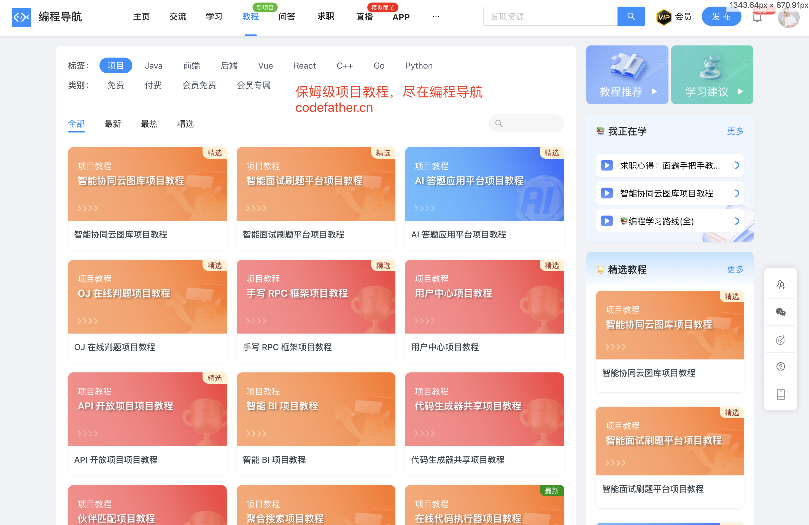

欢迎 [加入编程导航](https://mp.weixin.qq.com/s/I1oD6pAaWBvGLyFDT9AgvA?token=1925632390&lang=zh_CN) 或直接前往 [亿级流量点赞系统课程主页](https://www.codefather.cn/course/1912696290659577857)，解锁本项目与全部往期原创项目教程、学习指南与求职辅导。扫码下方优惠卡片即可领券加入，开启你的进阶编程之旅。

成为编程导航会员后，每天不到一元钱即可解锁全部项目的教程、源码、简历写法与面试题解，同时支持 PC 网页端与移动端 App 随时随地流畅学习。

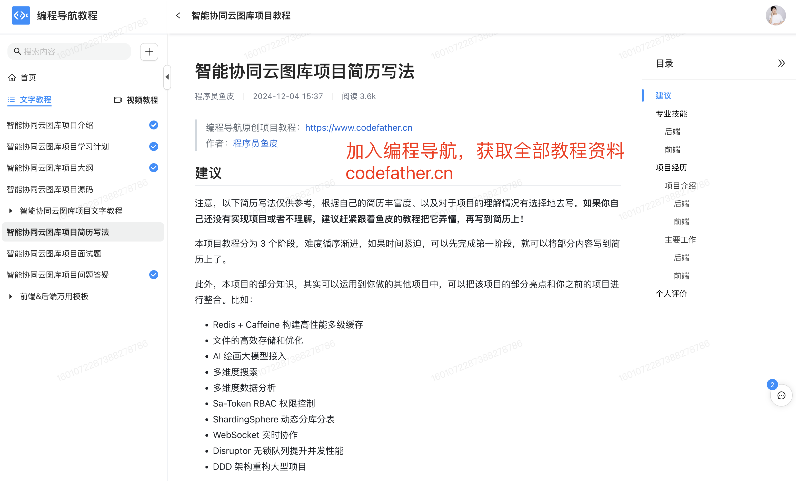

## 📚 更多原创实战项目与生态资源

如果你想一口气快速了解鱼皮的多套经典原创项目，可以观看 [编程导航系列项目合集介绍视频](https://www.bilibili.com/video/BV1YvmbYbEgS) 并利用视频底部章节条精准跳转。在掌握至少一门后端框架（如 Spring Boot）或前端框架（如 Vue）之后，你可以按照以下循序渐进的列表按需挑选项目查漏补缺。

1. [用户中心项目](https://www.codefather.cn/course/1790943469757837313/section/1790943553467756546?contentType=text&tabKey=list&type=)，非常适合新手入门，带你系统走通从零开发到部署上线的完整流程。
2. [伙伴匹配系统](https://www.codefather.cn/course/1790950013153095682/section/1790950295840796673?type=)，用于巩固全栈开发流程，重点实战 Redis 缓存、事务控制、并发编程与大数据相似度推荐算法。
3. [智能协同云图库](https://www.codefather.cn/course/1864210260732116994)，基于 Vue 3、Spring Boot、COS 与 WebSocket 的企业级全栈图库平台，深入落地 Redis 与 Caffeine 多级缓存、MySQL 分库分表、Sa-Token 权限控制、DDD 领域驱动设计、Disruptor 无锁队列与 AI 绘图大模型接入。
4. [API 开放平台](https://www.codefather.cn/course/1790979723916521474/section/1790982983314354177?type=)，实战前后端模板开发、分布式架构设计、SDK 封装、API 签名认证、Dubbo RPC 与 Gateway 微服务网关。
5. [手写 RPC 框架](https://www.code-nav.cn/course/1768543954720022530)，从零打造高性能技术轮子，实战自定义网络协议、序列化、Etcd 注册中心、Vert.x 网络服务器、动态代理、SPI 扩展机制、负载均衡、容错重试与注解驱动 Starter。
6. [聚合搜索平台](https://www.codefather.cn/course/1790979621621641217/section/1790981444839452673?type=)，实战网络爬虫、Elastic Stack 检索中台、多种设计模式、数据同步方案与 JMeter 压力测试。
7. [智能 BI 项目](https://www.codefather.cn/course/1790980531403927553/section/1790990821273153538?type=)，聚焦异步化改造、线程池优化、RabbitMQ 消息队列与 AIGC 智能数据分析提示词优化。
8. [OJ 判题系统](https://www.codefather.cn/course/1790980707917017089/section/1790992688770232322?type=)，覆盖多种设计模式、单体项目微服务架构改造、Linux 远程开发、Docker 代码沙箱隔离与 Java 安全控制。
9. [代码生成器共享平台](https://www.codefather.cn/course/1790980795074654209/section/1790994690166272001?type=)，深入命令行工具开发、FreeMarker 模板引擎、Vert.x、对象存储、系统存储与性能优化以及分布式任务调度。
10. [AI 答题应用平台](https://www.codefather.cn/course/1790274408835506178/section/1790284197938388993?type=)，贯通 React 跨端小程序、Vue 3 AI 应用站点、后端分库分表、分布式锁、幂等设计、RxJava 响应式编程、SSE 实时推送与线程池隔离。
11. [面试刷题平台](https://www.codefather.cn/course/1826803928691945473/section/1826806264818610177?type=)，实战 React 与 Next.js 服务端渲染、Redis 多级缓存、Elasticsearch 全文检索、Redisson 高级数据结构、HotKey 探测、Sa-Token、Nacos、Sentinel 流控与反爬虫设计。

以上所有项目的学习计划、视频与文字教程、源码、学员笔记、交流群答疑、简历写法、面试题解与扩展思路，均可在 [编程导航会员专区](https://www.codefather.cn/vip) 一键解锁。同时，在备战求职面试时强烈建议配合 [面试鸭](https://www.mianshiya.com/) 针对 Java、Redis、分布式与高并发高频真题集中冲刺；若希望进一步掌握 AI 编程提效与 AI 应用开发，也欢迎阅读开源的 [鱼皮 AI 编程教程（Vibe Coding）](https://github.com/liyupi/ai-guide)，探索 [鱼皮 AI 导航](https://ai.codefather.cn) 并学习 [AI 编程实战课](https://ai.codefather.cn/course/2087008226460565505)。更多鱼皮团队的开源工具与精选资源，均汇总在 [程序员鱼皮资源大全](http://dogyupi.com/) 中。

## 🔥 学员真实评价

已经有数万名小伙伴在编程导航跟着实战项目持续精进，还留下了大量高质量的自发复盘笔记。亲手做出硬核项目不仅能带来持续的正反馈，更能让你在面试官面前充满底气。

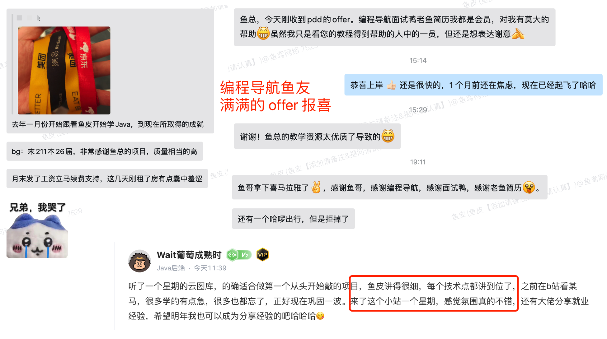

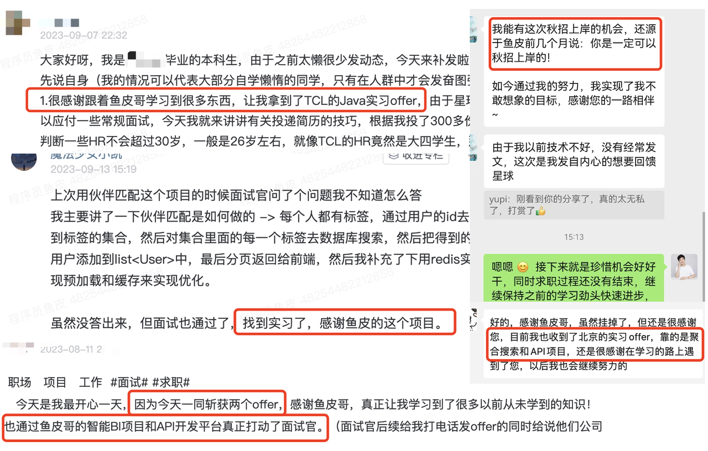

